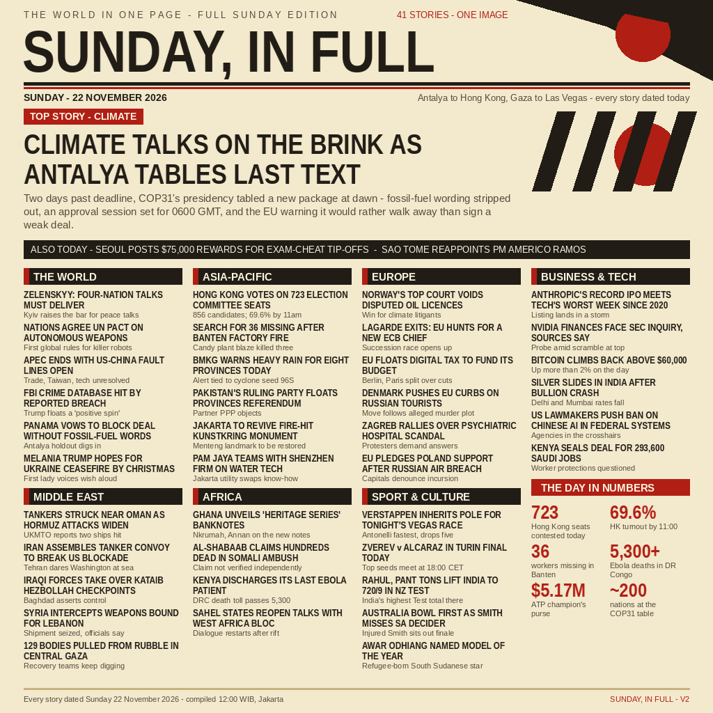

[](https://make.fun/bounty/news-image-20261122?utm_source=github&utm_medium=readme&utm_campaign=news-image-20261122)
[](https://make.fun/bounty/news-image-20261122/leaderboard?utm_source=github&utm_medium=readme&utm_campaign=news-image-20261122)
[](https://make.fun/bounty/news-image-20261122?utm_source=github&utm_medium=readme&utm_campaign=news-image-20261122)

# Sunday, In Full — World News, Sunday 22 November 2026

[](https://make.fun/c/news-image-20261122)
[](https://make.fun/c/news-image-20261122)
[](https://make.fun/c/news-image-20261122)

One image summing up the world's news of **Sunday 22 November 2026**:
32 dated stories across 6 regions, drawn as a sunlit front page
(warm sand paper, charcoal masthead, vivid red accent, hard diagonal
shadow — the "Sunlit Crime-Noir" editorial identity).



## The day in brief

**Lead — Russia's new overnight barrage.** About 550 munitions
(496 drones, 53 missiles) rain down on Ukraine overnight; 5 people are
killed and 10 injured. A family of four dies in Lapaivka, near Lviv;
one is killed and 10 hurt in Zaporizhzhia. Air defences down 439
drones and 39 missiles.

**COP31, Antalya.** A revised text is tabled early Sunday; President
Kurum says the gap is narrowing and a plenary is set for 10:00.
Fossil fuels stay in the draft; the 1.5°C goal is already conceded
as missed.

**FBI.** The FBI is investigating an apparent hack of its NCIC
criminal database, used by federal and local police.

## All 32 stories (with sources)

| # | Story | Source |
|---|-------|--------|
| 1 | Russia's overnight barrage: ~550 munitions, 5 killed, 10 injured; family of four killed in Lapaivka; Zaporizhzhia hit | Zelenskyy statement via KVNU/ABC; Ukraine Air Force |
| 2 | COP31: revised text tabled; Kurum says gap narrowing; plenary 10:00; fossil fuels in draft; 1.5°C conceded as missed | Reuters / AP via Stories of Record; Europe Says; BBC |
| 3 | FBI investigating apparent hack of NCIC criminal database | BBC, 22 Nov 00:10 UTC |
| 4 | Hong Kong: polls open for Election Committee; 856 candidates contest 723 seats | China Daily Asia, 22 Nov |
| 5 | Nepal: PM Balendra Shah arrives in New Delhi; first visit since March; talks with Modi Monday; ~$2bn package eyed | IANS, 22 Nov; The Hindu BusinessLine |
| 6 | AUKUS: Australia's Marles hits back at US CBO report on submarine numbers | Reuters, Sydney 22 Nov |
| 7 | Gaza aid: Australia, Canada, Italy, UK jointly urge Israel to open aid access as floods worsen the crisis | The Paris Eye, 22 Nov |
| 8 | Venezuela: US State Dept report puts oil and mineral revenue above $12bn, a year after Maduro's capture | The Paris Eye, 22 Nov |
| 9 | Israel: Eisenkot invites Likud to coalition talks resuming Sunday; mandate ends 6 Dec | Maariv via Europe Says |
| 10 | Gulf: Saudi coalition says it downed a Houthi missile and a drone bound for Riyadh | QNA via Fana News (announced 23:30 UTC Sat = 02:30 Sun Riyadh) |
| 11 | F1: Las Vegas GP under the lights tonight (04:00 UTC); Verstappen on pole, Russell alongside | Sportradar; VAVEL |
| 12 | Ashes: day two in Perth; Smith captains Australia with Cummins out injured | Times of India; Newspoint |
| 13 | NFL: Broncos host the Raiders; rookie QB Fernando Mendoza | Level Headlines |
| 14 | Cricket: India face New Zealand in windy Wellington | PW.live, 22 Nov |
| 15 | Iran web: draft rules tie online accounts to real identities, ending anonymous use | Digiato |
| 16 | COP31 AI: the summit's AI pledge fails to attract major US tech firms | PW.live, 22 Nov |
| 17 | Qeshm: Iran says island blasts were US munitions disposal, not a fresh attack | Times of India, 22 Nov |
| 18 | Oman: tankers hit off the coast as Iran–US naval tensions escalate | Times of India, 22 Nov |
| 19 | SCO: dialogue opens in New Delhi; Modi hails civilisational links; Pakistan to attend | Times of India, 22 Nov |
| 20 | France: prosecutors probe Depardieu and an author over a gang-rape claim | Times of India, 22 Nov |
| 21 | Snooker: Advani and Ramachandran win openers at the world championship | PW.live, 22 Nov |
| 22 | IFFI: Goa film festival adds an animation section with five films | PW.live, 22 Nov |
| 23 | Hormuz: ADNOC vessel attacked; one crew member reported missing | PW.live, 22 Nov |
| 24 | Chips: Bessent — no new curbs needed on Nvidia exports to China | Japako, 22 Nov 01:23 UTC |
| 25 | Gaza: 129 more bodies pulled from the rubble in central Gaza | Aggregator reports, 22 Nov |
| 26 | Somalia: satellite images show the UAE expanding airstrips | Aggregator reports, 22 Nov |
| 27 | Climate tech: EU's Copernicus showcases AI's role in tracking the atmosphere | Aggregator reports, 22 Nov |
| 28 | Victoria: early voting closed Sunday; state votes 28 Nov; Coalition leads 56–44 | InSnip, 22 Nov |
| 29 | Australia: south-east heat and storms; Melbourne 31°C, Sydney 31°C | Bureau of Meteorology via Marco Island Naples News, 22 Nov |
| 30 | New York: 'Turtle Lady' Lorri Cramer has taken in 680 baby turtles | Times of India, 22 Nov |
| 31 | Panama vows to block any COP31 deal without fossil-fuel language | Stories of Record, 22 Nov 00:11 UTC |
| 32 | AAA expects 81.5m Americans to travel 24–30 Nov (Thanksgiving week preview) | AAA via CNN coverage |

### Date discipline

Every story above happened, or was first reported, on 22 November
2026 in some time zone. Big stories from 20–21 November were
**deliberately left out** even though rival entries appear to carry
them: the Sinaloa cartel raid (20–21 Nov), the Bahrain strikes
(21 Nov), Bolsonaro's ICU admission (21 Nov), the EU–Indonesia
trade deal signing (21 Nov), the Peru M6.7 quake (21 Nov 00:09 UTC),
the Timor-Leste M6.8 quake (21 Nov 09:42 UTC), the France
cost-of-living protests (Sat 21 Nov), Trump's permanent Iran nuclear
accord announcement (Sat 21 Nov), Zelenskyy's G20 remarks (21 Nov)
and the Turkey–Hamas talks (21 Nov). The Gulf item (#10) is dated by
its announcement time: 23:30 UTC Saturday = 02:30 Sunday in Riyadh.
The AAA travel figure (#32) is a forecast for 24–30 Nov, published
ahead of the week — included as a preview, not a 22 Nov event.

The build ran at ~02:00–03:00 UTC on 22 November, so the entry
reflects the day's news as verified by then. A refresh later in the
day (COP31 plenary outcome, F1 result, Hong Kong results, US Sunday
news) could add more stories before the 24 Nov 00:00 UTC deadline.

## How to run

```sh
python3 build_entry.py   # writes entry.png (1024x1024, < 1 MiB)
MAKEFUN_OUTPUT_DIR=out python3 main.py   # copies entry.png to out/
```

`build_entry.py` needs only Python 3 + Pillow and the three photos in
`assets/` (AI-generated scenes, no text baked in). No network, no
randomness, no clock: two runs produce byte-identical output.
`main.py` uses only the standard library.

## Files

- `build_entry.py` — draws `entry.png` with PIL (Liberation Sans)
- `main.py` — ships `entry.png` to the make.fun output directory
- `entry.png` — the entry image (1024×1024 PNG)
- `assets/` — three AI-generated scene photos (Lviv dawn, COP31 hall,
  sunlit office), no text in any of them
- `LICENSE` — MIT (from the competition starter kit)

## Competition

- Bounty: [news-image-20261122 — Sum up 22 November's world news in
  one image](https://make.fun/c/news-image-20261122)
- Prizes: $20 / $12 / $6 for 1st–3rd, $2 for 4th–10th, $1.20 for
  11th–50th (USDC on Solana)
- Deadline: 24 November 2026, 00:00 UTC
